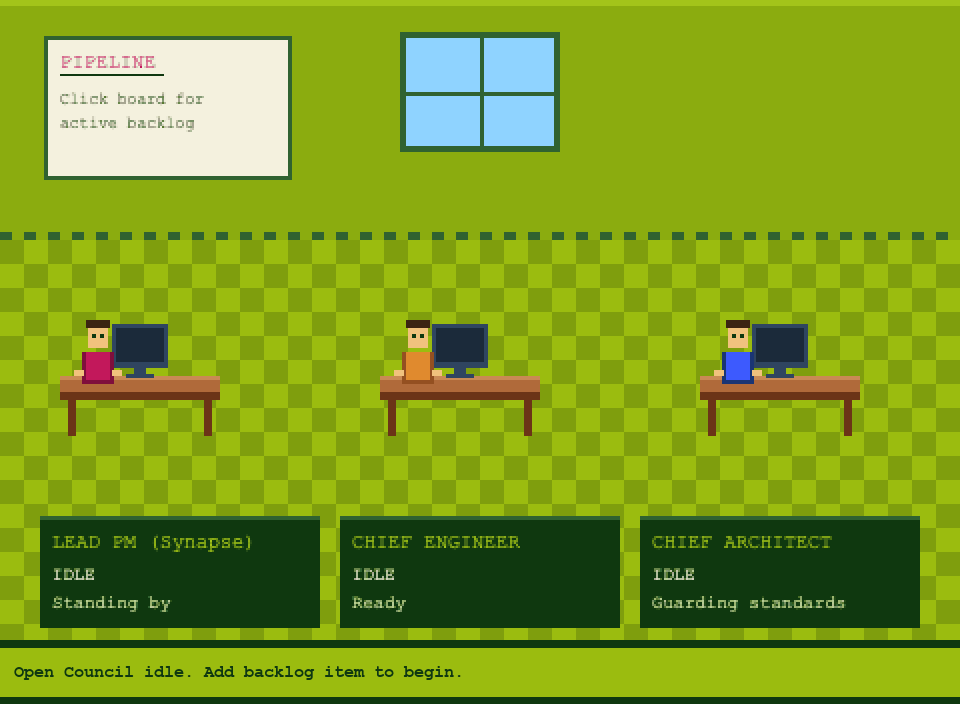
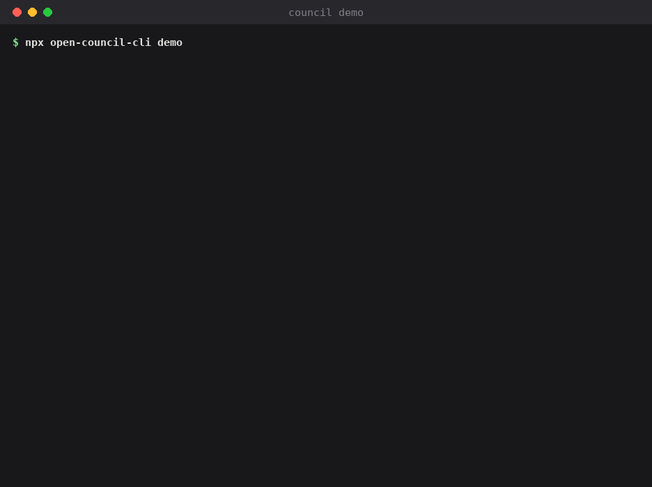
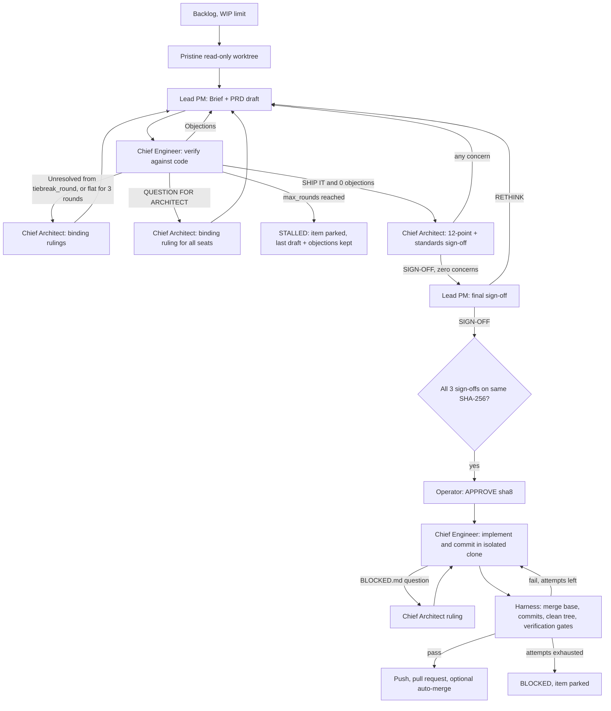

<div align="center">

# 🏛️ Open Council

### Three AIs argue over your spec until they agree. Then one ships it: tested, gated, as a pull request. It never says done when it isn't.

[](https://github.com/goshtasb/OpenCouncil/actions)
[](https://www.npmjs.com/package/open-council-cli)
[](https://opensource.org/licenses/MIT)
[](https://nodejs.org/)

**Point it at your own code first.** In any git repo with Claude Code installed:

```bash
npx open-council-cli review
```

**[See what it found in its own code →](docs/replays/council-review-reviews-itself.md)**

[Review your change](#-have-it-tear-into-your-change) •
[Install](#-install-in-one-line) •
[Step-by-step guide](#-step-by-step-guide-the-full-council) •
[Share a run](#-share-a-run) •
[Troubleshooting](#-troubleshooting) •
[How it is different](#-how-is-this-different-from-an-llm-council) •
[Showcases](#-showcases) •
[Honest limits](#-honest-limits) •
[How it works](#-how-it-works) •
[Roadmap](ROADMAP.md) •
[Contributing](CONTRIBUTING.md)



<sub>`council office`, replaying the seat states of the session that built <a href="https://github.com/goshtasb/OpenCouncil/pull/1">PR #1</a>. The seats take turns; the human only approves.</sub>

</div>

## 🔎 Have it tear into your change

The fastest way to see what Open Council does is to let it review something you were about to ship. No config, no `.council/` folder, nothing written to your repository and nothing executed.

```bash
cd your-repo
npx open-council-cli review                                          # your uncommitted change
npx open-council-cli review --base origin/main                       # or this branch since main
npx open-council-cli review "add rate limiting to the login route"   # or a plan, before you write any code
npx open-council-cli doctor                                          # just check which AIs are ready, and how to fix the rest
```

**You need:** Node 18 or newer, [Claude Code](https://claude.com/claude-code), and macOS, Linux or WSL. A review is one quick round by default: one call per seat. `--debate` runs the longer back-and-forth instead. It runs on your own account, one of two ways:

| | For | Set up | What it costs |
| :--- | :--- | :--- | :--- |
| **Your Claude plan** | You, on your own machine or your own repo | Run `claude` once and sign in (Pro, Max, Team or Enterprise) | Your plan's usage, like any other Claude Code session |
| **Your own API key** | Teams and companies | `export ANTHROPIC_API_KEY=...` (Bedrock and Vertex work too, through Claude Code's own settings) | Billed to your key: less than a two-round debate, which is roughly $1 to $2.50 for a normal pull request. That is an estimate from one measured run, a four-round review of a large diff that cost about $3.65 |

Before anything runs, the review checks every AI CLI it knows (Claude Code, Gemini through Antigravity's `agy`, Grok) with a one-word prompt in an empty folder, no tools and no repository files. Each line says ready, not installed, not signed in, or out of quota, with the exact command that fixes it:

```
  ✓ Claude        ready: answered on your Claude login  (2.1 s)
  ✗ Gemini (agy)  not installed: `agy` is not on PATH
      fix: curl -fsSL https://antigravity.google/cli/install.sh | bash  then  agy   (sign in through the browser prompt)
  ✓ Grok          ready: answered on your Grok login  (3.4 s)
Seats: Claude and Grok: Lead PM Claude (sonnet), Chief Engineer Claude (opus), Chief Architect Grok (grok-4.6).
```

The review then runs with whatever is ready. With Claude alone, the seats run on Claude's sonnet and opus models, and the review says plainly that it is a single-vendor review. It never claims vendors that did not answer: the line-up in `review.md` and `review.html` lists who actually held each seat. `--no-check` skips the check. The review also prints which login each seat uses. If `ANTHROPIC_API_KEY` is set, Claude Code bills that key, not your plan, and the review says so. Open Council never reads, stores or sends a credential; each AI CLI signs in by itself.

**What happens:**

1. It works out what to review. With no arguments, that is your uncommitted change, untracked files included. With nothing uncommitted, it is your branch's commits since `origin/main` (or `main`/`master`). Pass `--base <ref>` to pick the base yourself, or a sentence to review a plan instead of a diff.
2. It prints every file whose diff the seats will see, before they start. Untracked files that look like secrets (`.env*`, `*.pem`, `*.key`, `id_rsa` and the like) are never sent, and it names the ones it held back.
3. Three seats review it. The **Lead PM** writes down what the change claims to do. The **Chief Engineer** checks every claim against your code and objects with `file:line`. The **Chief Architect** rules on each objection: it stands (a defect that should block), it is minor (right, but it should not block), it needs a measurement, or it is overruled. With `--debate`, the Lead revises and the seats go back and forth, and the Architect rules again at the end. The seats read your project from a temporary checkout that is removed when the review ends.
4. It prints the verdict, the strongest objections and a line you can paste anywhere. The verdict is **PASS** when nothing that blocks is left (minor notes may be), and **CHANGES REQUESTED** when an objection stands, needs a measurement, or was never ruled on. Blocking objections come first; minor notes are listed after them and say they don't block. It also writes two files: `review.html`, one self-contained page, and `review.md`, ready for a gist or a pull request comment. The page opens in your browser when you run it in a terminal.

If a seat fails halfway (a usage limit, a lost login, a turn limit, an error), it moves to another model or AI for the rest of the review: Claude's opus falls back to sonnet first, and a lost login drops that AI. A seat only moves to an AI already on the Seats line. With a `.council/config.yml`, that means one its seats name; list others under `council.failover_providers` to allow them. If none is left for the Chief Architect, the review still finishes without its rulings. Either way the review keeps going and lists the gap under **Gaps in this review**, instead of failing the whole run.

The seats are whichever AI CLIs you have. Claude Code alone is enough: every seat then runs on it, with a different model, persona and tool access per seat. The test and lint commands are read from your `package.json`, `Cargo.toml`, `go.mod`, `pyproject.toml`, `setup.py` or `requirements.txt` so the seats know how the project is checked; a review never runs them.

| Option | What it does |
| :--- | :--- |
| `"<plan>"` | Review a one-line plan instead of a diff |
| `--base <ref>` | Review the commits ahead of `<ref>` instead of uncommitted changes |
| `--debate` | Run the full debate: two rounds, with revisions and a sign-off, instead of the one quick round |
| `--rounds <n>` | Round budget, 1 to 4 (default 1, or 2 with `--debate`). Round 1 carries most of the code objections |
| `--no-check` | Skip the setup check and treat every installed AI CLI as ready |
| `--gist` | Also put `review.md` in a secret GitHub gist with your `gh` CLI and print the link |
| `-o, --out <dir>` | Also copy `review.html` and `review.md` into `<dir>` |
| `--no-open` | Don't open the page in a browser |

**Sharing it:** `--gist` gives you a link in one step. Otherwise paste `review.md` into a gist, an issue or a PR comment, or send `review.html` as is: it has no scripts and loads nothing from the network. Read it first; it quotes your diff.

The first change it reviewed was its own. In round 1 the Chief Engineer found that a review could reset the checkout under another session running in the same repo, left that checkout registered afterwards, and sent untracked files, `.env` included, to the providers without a word. All five objections were fixed before it shipped. [Read the whole review](docs/replays/council-review-reviews-itself.md).



<sub>That review, played back with `council replay <session> --play`.</sub>

## 🤖 Review every pull request

The same review runs in GitHub Actions and posts what the council found as one comment on each pull request, with `file:line` objections first and a link to the full replay. Re-runs edit that comment instead of adding another. Every pull request in this repository gets one.

1. Pick a login and add it as a repository secret:
   - **Your Claude plan**, for a repo only you work in: run `claude setup-token`, then `gh secret set CLAUDE_CODE_OAUTH_TOKEN` and paste the token.
   - **Your own API key**, for a team or organization repo: `gh secret set ANTHROPIC_API_KEY`. Anthropic recommends a key rather than one person's plan token for anything shared.
2. Add `.github/workflows/council-review.yml`:

```yaml
name: Council review
on:
  pull_request:
    types: [opened, reopened, ready_for_review, labeled]
permissions:
  contents: read
  pull-requests: write
jobs:
  review:
    if: github.event.action != 'labeled' || github.event.label.name == 'council-review'
    concurrency:
      group: council-review-${{ github.event.pull_request.number }}
      cancel-in-progress: true
    runs-on: ubuntu-latest
    timeout-minutes: 30
    steps:
      - uses: actions/checkout@v5
        with:
          fetch-depth: 0
      - uses: goshtasb/OpenCouncil@main
        with:
          claude_code_oauth_token: ${{ secrets.CLAUDE_CODE_OAUTH_TOKEN }}   # or:
          # anthropic_api_key: ${{ secrets.ANTHROPIC_API_KEY }}
```

3. Open a pull request. To review it again after new commits, add the `council-review` label.

| Input | Default | What it does |
| :--- | :--- | :--- |
| `claude_code_oauth_token` | | Your plan token from `claude setup-token` |
| `anthropic_api_key` | | Your own Anthropic API key; used ahead of the plan token when both are set |
| `rounds` | `2` | Round budget, 2 to 4 |
| `github_token` | `github.token` | Posts the comment; needs `pull-requests: write` |

The `outcome` output is `PASS`, `CHANGES_REQUESTED`, `NO_VERDICT` (no seat reviewed the change) or `SKIPPED`.

It skips, with a notice and a green check, pull requests from forks (GitHub gives them no secrets), drafts, and runs with no login. The seats run in Claude Code's read-only plan mode on the runner, and the full replay is kept as the `open-council-review` artifact and in the run summary. Each review uses about four minutes of your plan or your key.

## ⚡ Install in one line

Only Claude Code installed? That is enough. `init` detects which CLIs you have and puts every seat on Claude Code when it is the only one (solo mode).

```bash
npx open-council-cli init     # writes .council/ and picks a provider for each seat
council doctor            # every seat answers, or you get the one command that fixes it
```

As a Claude Code plugin, so `/open-council:council "your task"` drives the whole loop from inside a session:

```text
/plugin marketplace add goshtasb/OpenCouncil
/plugin install open-council@open-council
```

As an agent skill for other agents (Cursor, Codex, Gemini CLI and the rest of the [skills](https://skills.sh) ecosystem):

```bash
npx skills add goshtasb/OpenCouncil
```

Node 18+, macOS or Linux. More options under [Other install methods](#-other-install-methods).

**What it costs you:** a paid Claude Code plan is enough (solo mode), or your own API key. A review takes about four minutes; a full council about 5 to 40. Both use your plan's quota or your key. See [Honest limits](#-honest-limits) before your first run.

## 📘 Step-by-step guide: the full council

`council review` stops at the argument. The full council goes all the way: the seats agree on a PRD, you approve it, the Chief Engineer builds it in an isolated clone, your gates run, and a pull request opens. Nothing is written to your repository before you approve.

### 1. Set up the repository

```bash
cd /path/to/your/repo
npx open-council-cli init --quick   # writes .council/; solo mode if Claude Code is your only AI CLI
council doctor                      # every seat answers, or you get the one command that fixes it
```

`init` writes `.council/` with `config.yml`, `CONSTITUTION.md`, `DELEGATION.md`, `personas/`, `references/` (reply contracts) and `standards/`. Commit it so the council reads the same rules every time. `--quick` sets the fast profile (at most 4 rounds, tie-break from round 3, the six starred review points, documents under 1,200 words); leave it off for the full 12-point council. `--solo` and `--full` force a seat plan, and `--force` rewrites an existing `config.yml` without touching your personas, contracts or standards. Session state lives outside the repo in `~/.council/projects/<repo>-<hash>/` (set `COUNCIL_HOME` to move it).

`npx open-council-cli` works for every command below. To type `council` instead, install it once with `npm install -g open-council-cli`.

### 2. Tell it what to build

Either queue it on the backlog (the WIP limit in `config.yml` keeps sessions from piling up):

```bash
council backlog add "Return 404 instead of 500 for unknown slugs" --priority 1 --body "Details..."
SESSION=$(council open unknown-slug-404 --item 001)
```

or open a session straight from a sentence or a file:

```bash
SESSION=$(council open unknown-slug-404 --task "Return 404 instead of 500 for unknown slugs")
SESSION=$(council open unknown-slug-404 --task-file task.md --quick)
```

`council open` prints only the session id, so it can be captured as above. `council status` lists every session and `council status $SESSION` shows one.

### 3. Let the seats argue

```bash
council deliberate $SESSION
```

This runs the whole loop and can be re-run to resume: the Lead PM drafts, the Chief Engineer checks it against the code round by round, the Chief Architect rules on questions and deadlocks, then signs off with zero concerns, and the Lead signs off last. The steps are also commands of their own: `draft`, `ask`, `tiebreak`, `architect-review`, `signoff`, `finalize`.

It ends one of two ways. When all three seats signed off the same document, it prints the PRD (Markdown and PDF) and an approval token. When the round budget runs out first, the session is `STALLED` and `stalled-draft-and-objections.md` in the session folder holds the last draft and every open objection.

### 4. Read the PRD and approve it

```bash
council prd $SESSION                         # the document all three seats signed off
council approve $SESSION "APPROVE 8a3f1b9c"  # use the token deliberate printed
```

This is the one decision that is yours. The token is the first 8 characters of the document's SHA-256, so it approves exactly the text you read.

### 5. Build it, check it, open the PR

```bash
council handoff $SESSION   # clones the repository for execution
council run $SESSION       # implement, merge your base branch, run the gates, push, open the PR
```

The Chief Engineer commits on `council/<slug>` in the clone. The harness merges the current tip of your base branch, runs your verification gates, and pushes and opens the pull request only if they pass. Anything that fails ends as `BLOCKED`, never as done. `council run $SESSION --skip-agent` re-runs only verification and publishing, for example after fixing a push problem. Pushing uses `git` and `gh`, so `origin` must be a GitHub remote you can push to and `gh auth status` must pass.

### 6. Configure your gates (recommended)

Gates are commands with exit codes, not a model's opinion. List them in `.council/config.yml`:

```yaml
verification:
  gates:
    - name: "test"
      command: "npm test"
      standard: "12-point #4 Testing & Release Engineering"
    - name: "dependency-audit"
      command: "npm audit --audit-level=high"
      standard: "12-point #3 Software Supply Chain"
```

Defining `gates` replaces the implicit `lint_command`/`test_command` pair, so list those too. `council init` writes a commented catalogue of examples, and `council gates` shows what will run without running anything.

### 7. Watch it (optional)

```bash
council office   # http://localhost:4321, served on 127.0.0.1 only
```

A pixel-art office where each seat types while its CLI is running. Click the whiteboard for the backlog.

## 📤 Share a run

Every session, from `council review` or the full council, can be turned into something you can send:

```bash
council replay $SESSION                  # one self-contained HTML page: <session id>.html
council replay $SESSION --out run.html   # or wherever you like
council replay $SESSION --play           # play it back in the terminal at reading pace (--fast for all at once)
```

`council replay` takes a session id (from `council status`) or a session folder. The page has every draft, objection, ruling and sign-off as the seats wrote them, the gate output and the diff, with no scripts and nothing loaded from the network. Paths under your home folder are shortened, but the page quotes your code, so read it before you publish it. The [replays](docs/replays/README.md) in this repository were made this way.

## 🧭 How is this different from an LLM council?

- **The debate produces a verified pull request, not an answer.** After you approve the PRD, the Chief Engineer implements it in an isolated clone, the harness merges your base branch, runs your verification gates, and opens the PR. Anything that fails is reported as `BLOCKED`, never as done.
- **Sign-off is unanimous and bound to one SHA-256, and the gates are commands.** A document reaches you only when all three seats signed off the byte-identical file: Engineer with zero objections, Architect with zero concerns, Lead last. `finalize` and `approve` re-check the hash. Lint, tests, audits and scans are commands with exit codes, not a model's opinion of itself.
- **It runs on accounts you already have.** Claude Code, Grok and Gemini CLIs on your own plans, or your own API keys for a team. Nothing is billed to anyone else, and Open Council never touches a credential.

## 🏛️ It wrote a feature for its own repository

The council was pointed at this codebase and asked for a small feature.

**Gemini** drafted a PRD. **Claude** read the actual source and came back with six objections citing `file:line`, including one that caught a mistake in **Grok**'s own ruling. Four rounds later Claude ratified it with zero objections, Grok signed off against a 12-point standards checklist with zero concerns, Gemini gave the final sign-off, and only then did a PDF land for a human to approve.

After approval Claude implemented it in an isolated clone, the harness ran the project's gates, and [PR #1](https://github.com/goshtasb/OpenCouncil/pull/1) opened by itself.

Then CI failed the PR. The branch compiled, `main` compiled, the merge did not. The harness had verified the branch in isolation while GitHub verifies the merge. So it now merges your base branch *before* running its gates, and the feature the council wrote (`council gates`) shipped in [v0.1.0](https://github.com/goshtasb/OpenCouncil/releases/tag/v0.1.0) alongside the fix.

That is the whole idea: **the disagreement is the product.** A single agent that agrees with you produces plausible code. Three agents with different jobs, one of which cannot write code at all, produce a specification someone can actually approve.



<sub>The same session, replayed from its transcript.</sub>

## 🏆 Showcases

Council runs on real repositories, with the objections the Engineer raised, what the Architect ruled, and what happened to the pull request. Each one is a short case study in [`docs/showcase/`](docs/showcase/).

| Repository | Task | Outcome |
| :--- | :--- | :--- |
| [goshtasb/OpenCouncil](https://github.com/goshtasb/OpenCouncil) | `council gates`: preview verification gates offline | [PR #1](https://github.com/goshtasb/OpenCouncil/pull/1), shipped in v0.1.0 after the merge-base fix ([case study](docs/showcase/opencouncil.md)) |
| [goshtasb/council-playground](https://github.com/goshtasb/council-playground) | `slugify('')` returns `''`; accented letters transliterated. First solo-mode councils (Claude Code only, quick profile) | Session 1 stalled at 5 rounds and changed the review rule; session 2 signed off in 1 round, 5 min, [PR #1](https://github.com/goshtasb/council-playground/pull/1) opened by the harness in 59 s ([case study](docs/showcase/council-playground.md)) |

A council that went wrong is just as useful here. Post yours in [Discussions → Show and tell](https://github.com/goshtasb/OpenCouncil/discussions/categories/show-and-tell).

## 🚧 Honest limits

- `council review` has one measured run at 3 rounds: 6 minutes, with the useful objections all in round 1 (2 min 44 s). That is why the default is now one quick round. The quick round's own time is not yet measured; the Lead PM reading the repository is likely the slowest part.
- A review with only Claude installed is a single-vendor review: the seats differ by model, persona and tool access, not by company. The review labels it that way.
- A full council takes roughly **10–40 minutes** and spends real subscription quota. The quick profile is bounded at 4 rounds; its typical time is not yet measured on enough runs to quote.
- Live runs so far are single digits. Before v0.2.0, **one in five stalled** without producing anything. v0.2.0 writes the last draft and the open objections on a stall, arbitrates early when objections stop dropping, and retries a seat that returns nothing once. Whether that moves the stall rate is not yet known; the numbers will be updated here as runs accumulate.
- Solo mode (every seat on Claude Code) is new in v0.2.0: the seats are told apart by persona, model and tool access, not by vendor. Two live runs so far, on one small task: one stalled on review churn (which changed the review rule), one signed off in a round and shipped a PR. That is not a rate.
- macOS and Linux only; gates run through a POSIX shell. CI covers Node 18/20/22 on Ubuntu and Node 22 on macOS.
- `gemini-cli` is unusable on current individual Gemini sign-ins; use the Antigravity CLI (`agy`) for Gemini seats, or give `gemini-cli` a `GEMINI_API_KEY`. Antigravity can't use an API key, so with a key set and `gemini-cli` installed the Lead PM seat moves to `gemini-cli`.
- The Ollama adapter is implemented but **experimental**: it has never completed a live council ([#2](https://github.com/goshtasb/OpenCouncil/issues/2)).
- Neither Antigravity nor `gemini-cli` can be stripped of tools, so neither may hold the zero-tool Architect seat. `init` never assigns them there and `doctor` warns if you do.

Found one of these the hard way? [Tell us](https://github.com/goshtasb/OpenCouncil/issues/new/choose). A council that went wrong is the most useful bug report this project can get.

**Coming next:** the Charm, a phone voice companion for the council. See the [roadmap](ROADMAP.md).

## 🔒 What it runs and what it sends

Open Council runs on your machine. The Claude Code plugin adds one skill, `/open-council:council`, which runs the `council` CLI (or `npx open-council-cli` if it isn't installed), plus `git` and `gh`.

- Your task and the code the seats read go to the AI CLIs you assigned to the seats: Claude Code, plus any other provider CLI from [Providers](#-providers) you set up. Each CLI sends it to its own provider under your own account. In solo mode only Claude Code is used. An Ollama seat talks to your local Ollama.
- `council review` writes nothing to your repository and runs nothing in it. The seats see the diff (minus untracked files that look like secrets) and read the project from a temporary checkout that is removed afterwards. Its files go to `~/.council`.
- In the full council, nothing is written to your repository before you approve the PRD. After that it commits in an isolated clone, pushes a branch and opens a pull request on your repository's remote with `gh`.
- Session records stay on your machine under `~/.council`. The CLI has no telemetry and calls no server of its own. `council office` serves its dashboard on 127.0.0.1 only.

## 💡 How it works

One decision reaches you: approve the PRD, or don't. Nothing is written before that.

| Seat | Runs as (full council) | Runs as (solo mode) | Job | Cannot |
| :--- | :--- | :--- | :--- | :--- |
| **Lead PM** (*Synapse*) | Gemini via Antigravity | Claude Code, `sonnet` | Researches the repo, writes and revises the Brief + PRD, signs off last | Edit code |
| **Chief Engineer** | Claude Code, `opus` | Claude Code, `opus` | Verifies every claim against the code, objects with `file:line`, implements after approval | Ratify what it cannot test |
| **Chief Architect** | Grok | Claude Code, `sonnet`, all tools off | Breaks deadlocks, rules on undefined rules, audits against 12 standards | See your repository at all |
| **You** | Human | Human | Approve the finished PRD | Be interrupted for anything else |

A document reaches you only when all three have signed off **the byte-identical file**: the Engineer with zero objections, the Architect with zero concerns, the Lead last. `finalize` and `approve` both re-check that against its SHA-256. After your approval the Chief Engineer works in a throwaway clone, the harness merges your base branch, runs your verification gates, and pushes only if they pass. Anything that fails is reported as `BLOCKED`, never as done.

### What happens when it does not converge

- Open objections flat for three rounds: the Chief Architect arbitrates right away instead of waiting for `tiebreak_round`.
- A resubmitted document: the Architect sees its previous review and the council's response, and a concern it could have raised last time and did not is waived. New concerns must name what the revision introduced.
- A seat returns nothing or drops the connection: one retry after five seconds. Timeouts are not retried.
- `max_rounds` passes without unanimous sign-off: the session stops as `STALLED`, the backlog item is parked, and `stalled-draft-and-objections.md` in the session holds the task, the last draft and every open objection, ruling and concern. It is marked unapproved and `approve` refuses it.

### Key features

* **Adversarial deliberation**: multi-round debate between PM and Engineer until the Engineer ratifies (`SHIP IT` + 0 open objections).
* **Binding arbitration**: from `tiebreak_round` on, or earlier when objections stop dropping, every unresolved round is arbitrated by the Chief Architect.
* **No human in the loop**: any seat that needs a rule the standards do not define writes `QUESTION FOR ARCHITECT: …`; the ruling binds every seat, during execution too.
* **Unanimous, zero-concern, hash-bound sign-off**: the Operator only sees a PRD that the Engineer ratified, the Architect signed off with zero REQUIRED and zero ADVISORY concerns, and the Lead signed off, all on the same SHA-256.
* **12-point industry standards review**: SOC 2/ISO 27001 change management, OWASP ASVS + NIST SSDF, SLSA/SBOM supply chain, test pyramid and release engineering, GDPR/DPIA, ISO 42010 ADRs and ISO 29148 requirement quality, SRE SLOs with OpenTelemetry, progressive delivery and expand-contract migrations, WCAG 2.2 AA and ICU i18n, SemVer/OpenAPI/RFC 9457 contracts, p95 and cost budgets, OWASP LLM Top 10. The quick profile audits the six starred points.
* **Engineering standards**: `.council/standards/` (manifest, architecture, coding practices, documentation) reaches every seat; seats cite rules by number, name and section.
* **Your plan or your own key**: drives the CLIs you already pay for, signed in with your plan or your own API key.
* **Verified hands-off execution**: the Chief Engineer commits on `council/<slug>` in an isolated clone; blockers go to the Architect and failed checks back to the Engineer (bounded by `execution_attempts`). The harness checks for commits and a clean tree, runs your gates, pushes, opens the PR, optionally enables auto-merge.
* **Verified against what will land**: the harness merges the current tip of `base_branch` before the gates run, so a change that builds alone but breaks once merged is caught before CI. A conflict blocks the PR instead of pushing a broken merge.
* **Machine-enforced gates**: `verification.gates` is an ordered list of commands (lint, typecheck, tests, `npm audit`, license check, CycloneDX SBOM, gitleaks, semgrep, axe, performance budgets), each with a timeout, a `required` flag and the standard it enforces. Every run writes an immutable evidence record and a gate summary into the pull request body.
* **Retro pixel-art office**: a local (127.0.0.1) dashboard showing which seat is working and the backlog.

## 💳 Providers

| Provider id | CLI | Notes |
| :--- | :--- | :--- |
| `claude-code` | `claude` | Plan mode for research; `--tools ''` for the zero-tool Architect seat; `bypassPermissions` only for execution in the isolated clone. |
| `grok-cli` | `grok` (or `$GROK_BIN`, `~/.grok/bin/grok`) | No-tool seats run with tools denied. |
| `antigravity` | `agy` | Scoped to the worktree with `--add-dir`. |
| `gemini-cli` | `gemini` | Some Gemini Code Assist tiers no longer accept this client; use `antigravity` instead. |
| `ollama` | `ollama` | Local models; no tool use. Experimental ([#2](https://github.com/goshtasb/OpenCouncil/issues/2)). |

`council init` writes the seats for the CLIs it finds; `council init --solo --force` or `--full --force` rewrites them. Then `council doctor` asks every seat for a live reply and prints, for each failure, the one command that fixes it:

```yaml
seats:
  lead_pm:
    provider: "antigravity"
    model: "gemini-4-argon-high"
  chief_engineer:
    provider: "claude-code"
    model: "opus"
  chief_architect:
    provider: "grok-cli"
    model: "grok-4.6"
```

## 🩺 Troubleshooting

| You see | What to do |
| :--- | :--- |
| `No AI CLI was found on PATH` | Install Claude Code (`curl -fsSL https://claude.ai/install.sh \| bash`), run `claude` once to sign in, then try again. |
| `council review runs inside a git repository` | `cd` into the repository, or `git init` and commit first. |
| `Nothing to review` | There is no uncommitted change and no commit ahead of the base. Pass `--base <ref>`, or a plan in quotes. |
| `The change is … KB … more than one review can argue about well` | Commit part of it and review the rest, or pass a closer `--base`. |
| `--rounds takes a whole number from 1 to 4` | A review is capped at 4 rounds. |
| `No AI CLI is ready to hold a seat` | Every check failed. Run the `fix:` command printed under Claude, or `npx open-council-cli doctor` to check again. |
| A line under **Gaps in this review** | That seat's AI failed partway and another took over, or nobody could. The line says why; the fix is usually the sign-in or a wait for the usage limit. |
| A seat fails in `council doctor` | Run the command `doctor` prints under it; it is the install or sign-in step for that CLI. `council doctor --no-live` checks installs without calling any model. Outside a set-up repository, `doctor` checks every AI CLI and says which seats a review would use. |
| The session ends `STALLED` | No document reached you, so nothing was built. Read `stalled-draft-and-objections.md` in the session folder (`council status $SESSION` shows where), sharpen the task, and open a new session. |
| The session ends `BLOCKED` | A gate failed, the merge with your base branch conflicted, or the push or PR could not be made. The reason is in `council status $SESSION`. Fix it and run `council run $SESSION --skip-agent`. |
| The PR step fails | Check `gh auth status`, and that `origin` is a GitHub remote you can push to. |
| `gemini-cli` seats fail | Current individual Gemini tiers reject that client. Use the Antigravity CLI (`agy`) for Gemini seats. |
| You're on Windows | Use WSL. Native Windows stops with a message, because gates run through a POSIX shell. |

Still stuck? Open an issue with the output of `council doctor` and, if you can, a replay of the session.

## 📦 Other install methods

```bash
npm install -g open-council-cli                # global install from npm; the commands are `council` and `open-council`
npm install -g https://github.com/goshtasb/OpenCouncil/releases/download/v0.4.0/open-council-cli-0.4.0.tgz   # release tarball, no registry
git clone https://github.com/goshtasb/OpenCouncil && cd OpenCouncil && npm ci && npm run build   # from source; see CONTRIBUTING.md
```

## 🏛️ Architecture



## 💻 Supported platforms

macOS and Linux, Node 18+. Windows is not supported: the harness runs verification gates and project commands through a POSIX shell. Use WSL there.

## 🧪 Development

```bash
npm ci
npm run build
npm test      # node:test suite with scripted seats; no model calls
```

## 🤝 Contributing

Start with [Your first contribution](CONTRIBUTING.md#your-first-contribution): report a run, pick a [`good first issue`](https://github.com/goshtasb/OpenCouncil/issues?q=is%3Aissue+is%3Aopen+label%3A%22good+first+issue%22), or add your CLI as a seat. The test suite needs no API credit. Everyone taking part agrees to the [Code of Conduct](CODE_OF_CONDUCT.md).

## 📄 License

Open Council is open-sourced under the [MIT License](LICENSE).

---

[](https://star-history.com/#goshtasb/OpenCouncil&Date)
