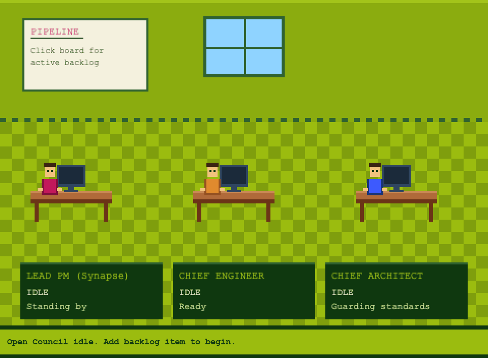
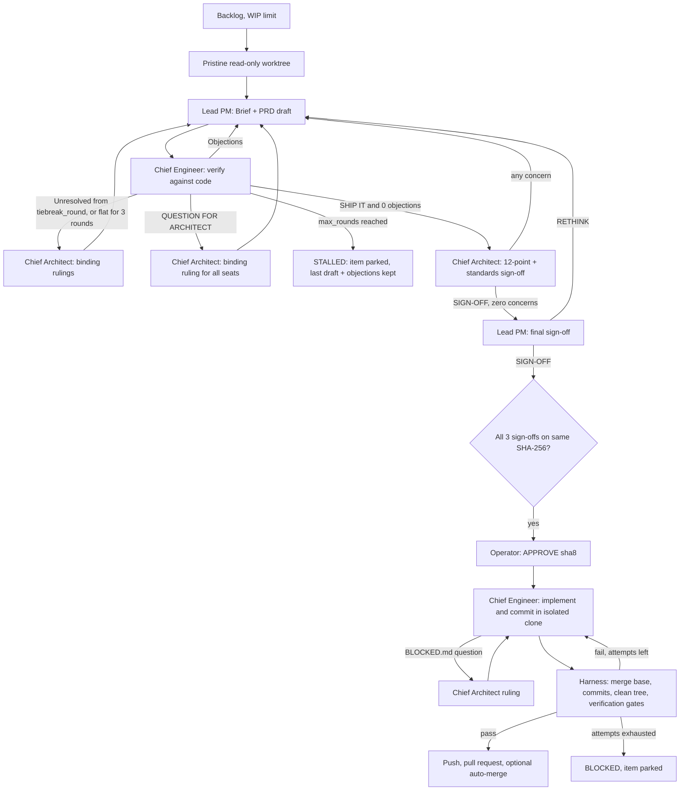

<div align="center">

# 🏛️ Open Council

### Three AIs argue over your spec until they agree. Then one ships it: tested, gated, as a pull request. It never says done when it isn't.

[](https://github.com/goshtasb/OpenCouncil/actions)
[](https://www.npmjs.com/package/open-council-cli)
[](https://opensource.org/licenses/MIT)
[](https://nodejs.org/)

[Install](#-install-in-one-line) •
[Five-minute run](#-your-first-council-in-five-minutes) •
[How it is different](#-how-is-this-different-from-an-llm-council) •
[Showcases](#-showcases) •
[Honest limits](#-honest-limits) •
[How it works](#-how-it-works) •
[Roadmap](ROADMAP.md) •
[Contributing](CONTRIBUTING.md)



<sub>`council office`, replaying the seat states of the session that built <a href="https://github.com/goshtasb/OpenCouncil/pull/1">PR #1</a>. The seats take turns; the human only approves.</sub>

</div>

## ⚡ Install in one line

Only Claude Code installed? That is enough. `init` detects which CLIs you have and puts every seat on Claude Code when it is the only one (solo mode).

```bash
npx open-council-cli init     # writes .council/ and picks a provider for each seat
council doctor            # every seat answers, or you get the one command that fixes it
```

As a Claude Code plugin, so `/open-council:council "your task"` drives the whole loop from inside a session:

```text
/plugin marketplace add goshtasb/OpenCouncil
/plugin install open-council@open-council
```

As an agent skill for other agents (Cursor, Codex, Gemini CLI and the rest of the [skills](https://skills.sh) ecosystem):

```bash
npx skills add goshtasb/OpenCouncil
```

Node 18+, macOS or Linux. More options under [Other install methods](#-other-install-methods).

## ⏱️ Your first council in five minutes

```bash
cd /path/to/your/repo
npx open-council-cli init --quick                       # solo mode if only Claude Code is installed
council doctor
council backlog add "Return 404 instead of 500 for unknown slugs" --priority 1
SESSION=$(council open unknown-slug-404 --item 001)
council deliberate $SESSION                         # quick profile: at most 4 rounds
```

When the three seats have signed off the same document, it prints the PRD (Markdown and PDF) and the one command that is yours:

```bash
council approve $SESSION "APPROVE 8a3f1b9c"         # the token is printed after sign-off
council handoff $SESSION && council run $SESSION    # implement in a clone, run the gates, open the PR
```

`--quick` is the fast profile: 4 rounds, tie-break from round 3, the six starred review points, documents under 1,200 words. Leave it off for the full 12-point council on work that deserves it.

## 🧭 How is this different from an LLM council?

- **The debate produces a verified pull request, not an answer.** After you approve the PRD, the Chief Engineer implements it in an isolated clone, the harness merges your base branch, runs your verification gates, and opens the PR. Anything that fails is reported as `BLOCKED`, never as done.
- **Sign-off is unanimous and bound to one SHA-256, and the gates are commands.** A document reaches you only when all three seats signed off the byte-identical file: Engineer with zero objections, Architect with zero concerns, Lead last. `finalize` and `approve` re-check the hash. Lint, tests, audits and scans are commands with exit codes, not a model's opinion of itself.
- **It runs on the subscriptions you already pay for.** Claude Code, Grok, Antigravity (Gemini): the CLIs, not API keys. Zero tokens billed outside your plans.

## 🏛️ It wrote a feature for its own repository

The council was pointed at this codebase and asked for a small feature.

**Gemini** drafted a PRD. **Claude** read the actual source and came back with six objections citing `file:line`, including one that caught a mistake in **Grok**'s own ruling. Four rounds later Claude ratified it with zero objections, Grok signed off against a 12-point standards checklist with zero concerns, Gemini gave the final sign-off, and only then did a PDF land for a human to approve.

After approval Claude implemented it in an isolated clone, the harness ran the project's gates, and [PR #1](https://github.com/goshtasb/OpenCouncil/pull/1) opened by itself.

Then CI failed the PR. The branch compiled, `main` compiled, the merge did not. The harness had verified the branch in isolation while GitHub verifies the merge. So it now merges your base branch *before* running its gates, and the feature the council wrote (`council gates`) shipped in [v0.1.0](https://github.com/goshtasb/OpenCouncil/releases/tag/v0.1.0) alongside the fix.

That is the whole idea: **the disagreement is the product.** A single agent that agrees with you produces plausible code. Three agents with different jobs, one of which cannot write code at all, produce a specification someone can actually approve.



<sub>The same session, replayed from its transcript.</sub>

## 🏆 Showcases

Council runs on real repositories, with the objections the Engineer raised, what the Architect ruled, and what happened to the pull request. Each one is a short case study in [`docs/showcase/`](docs/showcase/).

| Repository | Task | Outcome |
| :--- | :--- | :--- |
| [goshtasb/OpenCouncil](https://github.com/goshtasb/OpenCouncil) | `council gates`: preview verification gates offline | [PR #1](https://github.com/goshtasb/OpenCouncil/pull/1), shipped in v0.1.0 after the merge-base fix ([case study](docs/showcase/opencouncil.md)) |
| [goshtasb/council-playground](https://github.com/goshtasb/council-playground) | `slugify('')` returns `''`; accented letters transliterated. First solo-mode councils (Claude Code only, quick profile) | Session 1 stalled at 5 rounds and changed the review rule; session 2 signed off in 1 round, 5 min, [PR #1](https://github.com/goshtasb/council-playground/pull/1) opened by the harness in 59 s ([case study](docs/showcase/council-playground.md)) |

A council that went wrong is just as useful here. Post yours in [Discussions → Show and tell](https://github.com/goshtasb/OpenCouncil/discussions/categories/show-and-tell).

## ⚠️ Honest limits

- A full council takes roughly **10–40 minutes** and spends real subscription quota. The quick profile is bounded at 4 rounds; its typical time is not yet measured on enough runs to quote.
- Live runs so far are single digits. Before v0.2.0, **one in five stalled** without producing anything. v0.2.0 writes the last draft and the open objections on a stall, arbitrates early when objections stop dropping, and retries a seat that returns nothing once. Whether that moves the stall rate is not yet known; the numbers will be updated here as runs accumulate.
- Solo mode (every seat on Claude Code) is new in v0.2.0: the seats are told apart by persona, model and tool access, not by vendor. Two live runs so far, on one small task: one stalled on review churn (which changed the review rule), one signed off in a round and shipped a PR. That is not a rate.
- macOS and Linux only; gates run through a POSIX shell. CI covers Node 18/20/22 on Ubuntu and Node 22 on macOS.
- `gemini-cli` is unusable on current individual Gemini tiers; use the Antigravity CLI (`agy`) for Gemini seats.
- The Ollama adapter is implemented but **experimental**: it has never completed a live council ([#2](https://github.com/goshtasb/OpenCouncil/issues/2)).
- Neither Antigravity nor `gemini-cli` can be stripped of tools, so neither may hold the zero-tool Architect seat. `init` never assigns them there and `doctor` warns if you do.

Found one of these the hard way? [Tell us](https://github.com/goshtasb/OpenCouncil/issues/new/choose). A council that went wrong is the most useful bug report this project can get.

**Coming next:** the Charm, a phone voice companion for the council. See the [roadmap](ROADMAP.md).

## 💡 How it works

One decision reaches you: approve the PRD, or don't. Nothing is written before that.

| Seat | Runs as (full council) | Runs as (solo mode) | Job | Cannot |
| :--- | :--- | :--- | :--- | :--- |
| **Lead PM** (*Synapse*) | Gemini via Antigravity | Claude Code, `sonnet` | Researches the repo, writes and revises the Brief + PRD, signs off last | Edit code |
| **Chief Engineer** | Claude Code, `opus` | Claude Code, `opus` | Verifies every claim against the code, objects with `file:line`, implements after approval | Ratify what it cannot test |
| **Chief Architect** | Grok | Claude Code, `sonnet`, all tools off | Breaks deadlocks, rules on undefined rules, audits against 12 standards | See your repository at all |
| **You** | Human | Human | Approve the finished PRD | Be interrupted for anything else |

A document reaches you only when all three have signed off **the byte-identical file**: the Engineer with zero objections, the Architect with zero concerns, the Lead last. `finalize` and `approve` both re-check that against its SHA-256. After your approval the Chief Engineer works in a throwaway clone, the harness merges your base branch, runs your verification gates, and pushes only if they pass. Anything that fails is reported as `BLOCKED`, never as done.

### What happens when it does not converge

- Open objections flat for three rounds: the Chief Architect arbitrates right away instead of waiting for `tiebreak_round`.
- A resubmitted document: the Architect sees its previous review and the council's response, and a concern it could have raised last time and did not is waived. New concerns must name what the revision introduced.
- A seat returns nothing or drops the connection: one retry after five seconds. Timeouts are not retried.
- `max_rounds` passes without unanimous sign-off: the session stops as `STALLED`, the backlog item is parked, and `stalled-draft-and-objections.md` in the session holds the task, the last draft and every open objection, ruling and concern. It is marked unapproved and `approve` refuses it.

### Key features

* **Adversarial deliberation**: multi-round debate between PM and Engineer until the Engineer ratifies (`SHIP IT` + 0 open objections).
* **Binding arbitration**: from `tiebreak_round` on, or earlier when objections stop dropping, every unresolved round is arbitrated by the Chief Architect.
* **No human in the loop**: any seat that needs a rule the standards do not define writes `QUESTION FOR ARCHITECT: …`; the ruling binds every seat, during execution too.
* **Unanimous, zero-concern, hash-bound sign-off**: the Operator only sees a PRD that the Engineer ratified, the Architect signed off with zero REQUIRED and zero ADVISORY concerns, and the Lead signed off, all on the same SHA-256.
* **12-point industry standards review**: SOC 2/ISO 27001 change management, OWASP ASVS + NIST SSDF, SLSA/SBOM supply chain, test pyramid and release engineering, GDPR/DPIA, ISO 42010 ADRs and ISO 29148 requirement quality, SRE SLOs with OpenTelemetry, progressive delivery and expand-contract migrations, WCAG 2.2 AA and ICU i18n, SemVer/OpenAPI/RFC 9457 contracts, p95 and cost budgets, OWASP LLM Top 10. The quick profile audits the six starred points.
* **Engineering standards**: `.council/standards/` (manifest, architecture, coding practices, documentation) reaches every seat; seats cite rules by number, name and section.
* **Subscription-first, zero API keys**: drives the CLIs you already pay for.
* **Verified hands-off execution**: the Chief Engineer commits on `council/<slug>` in an isolated clone; blockers go to the Architect and failed checks back to the Engineer (bounded by `execution_attempts`). The harness checks for commits and a clean tree, runs your gates, pushes, opens the PR, optionally enables auto-merge.
* **Verified against what will land**: the harness merges the current tip of `base_branch` before the gates run, so a change that builds alone but breaks once merged is caught before CI. A conflict blocks the PR instead of pushing a broken merge.
* **Machine-enforced gates**: `verification.gates` is an ordered list of commands (lint, typecheck, tests, `npm audit`, license check, CycloneDX SBOM, gitleaks, semgrep, axe, performance budgets), each with a timeout, a `required` flag and the standard it enforces. Every run writes an immutable evidence record and a gate summary into the pull request body.
* **Retro pixel-art office**: a local (127.0.0.1) dashboard showing which seat is working and the backlog.

## 💳 Providers

| Provider id | CLI | Notes |
| :--- | :--- | :--- |
| `claude-code` | `claude` | Plan mode for research; `--tools ''` for the zero-tool Architect seat; `bypassPermissions` only for execution in the isolated clone. |
| `grok-cli` | `grok` (or `$GROK_BIN`, `~/.grok/bin/grok`) | No-tool seats run with tools denied. |
| `antigravity` | `agy` | Scoped to the worktree with `--add-dir`. |
| `gemini-cli` | `gemini` | Some Gemini Code Assist tiers no longer accept this client; use `antigravity` instead. |
| `ollama` | `ollama` | Local models; no tool use. Experimental ([#2](https://github.com/goshtasb/OpenCouncil/issues/2)). |

`council init` writes the seats for the CLIs it finds; `council init --solo --force` or `--full --force` rewrites them. Then `council doctor` asks every seat for a live reply and prints, for each failure, the one command that fixes it:

```yaml
seats:
  lead_pm:
    provider: "antigravity"
    model: "gemini-3.1-pro-high"
  chief_engineer:
    provider: "claude-code"
    model: "opus"
  chief_architect:
    provider: "grok-cli"
    model: "grok-4.6"
```

## 🕹️ The retro pixel office

```bash
council office          # http://localhost:4321 (office.port)
```

* Seat sprites type while that seat's CLI is running and rest when idle.
* Click the whiteboard to view the backlog.
* The ticker shows the active backlog item.

## 🚀 The full run

### 1. Initialize

```bash
council init          # or --quick, --solo, --full; --force rewrites config.yml
council doctor
```

This writes `.council/` with `config.yml`, `CONSTITUTION.md`, `DELEGATION.md`, `personas/`, `references/` (reply contracts) and `standards/`. Harness state (backlog, sessions, worktrees, execution clones) lives outside the repo in `~/.council/projects/<repo>-<hash>/` (override with `COUNCIL_HOME`).

### 2. Queue an item (WIP limit from config)

```bash
council backlog add "Add Stripe webhook idempotency and audit logs" --priority 1 --body "Details..."
```

### 3. Deliberate

```bash
SESSION=$(council open stripe-webhook-idempotency --item 001)   # or --task / --task-file; add --quick
council deliberate $SESSION
```

`deliberate` runs the whole loop: Lead drafts → Engineer rounds → Architect rulings on questions → tie-breaks → Architect sign-off (zero concerns) → Lead sign-off → finalize. It is resumable. Individual steps are also available: `draft`, `ask`, `tiebreak`, `review`, `signoff`, `finalize`, `status`, `gates`.

### 4. Configure verification gates (optional but recommended)

```yaml
verification:
  gates:
    - name: "test"
      command: "npm test"
      standard: "12-point #4 Testing & Release Engineering"
    - name: "dependency-audit"
      command: "npm audit --audit-level=high"
      standard: "12-point #3 Software Supply Chain"
```

Defining `gates` replaces the implicit `lint_command`/`test_command` pair, so list those too. `council init` writes a commented catalogue of gate examples; `council gates` previews them without running anything.

### 5. Approve and execute

```bash
council approve $SESSION "APPROVE 8a3f1b9c"   # token printed after finalization
council handoff $SESSION
council run $SESSION                           # --skip-agent re-runs only verification and publishing
```

Pushing and PR creation use `git` and the `gh` CLI, so `origin` must be a GitHub remote you can push to.

## 📦 Other install methods

```bash
npm install -g open-council-cli                # global install from npm; the commands are `council` and `open-council`
npm install -g https://github.com/goshtasb/OpenCouncil/releases/download/v0.2.0/open-council-cli-0.2.0.tgz   # release tarball, no registry
git clone https://github.com/goshtasb/OpenCouncil && cd OpenCouncil && npm ci && npm run build   # from source; see CONTRIBUTING.md
```

## 🏛️ Architecture



## 💻 Supported platforms

macOS and Linux, Node 18+. Windows is not supported: the harness runs verification gates and project commands through a POSIX shell. Use WSL there.

## 🧪 Development

```bash
npm ci
npm run build
npm test      # node:test suite with scripted seats; no model calls
```

## 📄 License

Open Council is open-sourced under the [MIT License](LICENSE).

---

[](https://star-history.com/#goshtasb/OpenCouncil&Date)
